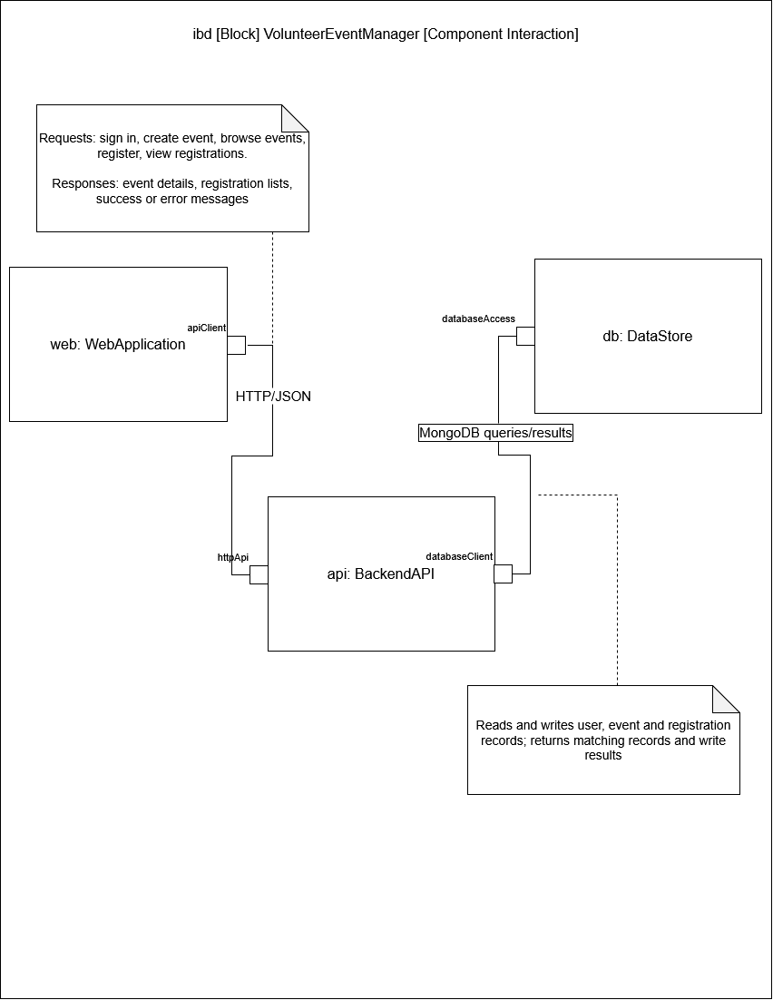

## **Title & Summary**
Volunteer Event Management System: For Organisers of events to create events and Volunteers to register their service to an event.

---

## **Features**

- Roles (REQ-05): Create roles for Organiser and Volunteer, volunteer assigned default to user public registration
- Create Event (REQ-01): Organiser to create events for a volunteer
- Browse Details (REQ-02): Volunteer to view the event details, available places left and other information start and finish time, and location
- Organiser View Registrations (REQ-04): Organiser to view the volunteers details registered to its event, the number of volunteers registered and capacity of left
- Event Registration (REQ-03): Register for Events

---

## **Tech Stack**

MongoDB Atlas, Express, React (with Tailwind), Node 22, deployed with nginx and PM2 on AWS EC2

---

## **Architecture**

## **Local Setup**

Virtual Box Ubuntu Server VM, Clone, npm install(root, backend and frontend), create backend/.env, npm run dev

- MONGO_URI
- JWT_SECRET
- PORT

---

## **Frontend API URL**

- Local: `REACT_APP_API_URL=http://192.168.1.120:5001` in `frontend/.env.local`
- Production (EC2): build with `REACT_APP_API_URL=/` so the site and `/api` share the same address via nginx

---

## **Running Tests**

- Running Tests:
  **registerForEvent()**

  - U1 returns 404 for malformed ID
  - U2 returns 409 already registered
  - U3 returns 404 event does not exis
  - U4 returns 409 event is full
  - U5 returns 201 registration successful

  **getEvents()**

  - returns 200 and all events, time, date with sorting
  - returns 200 and no event created []

  **getEventById()**

  - returns a 404 for a malformed id without database queryin
  - returns a 404 valid ID matches no event
  - returns a 200 and an event

    ****

  - cd backend && npm run test (10 passes)
  - postman collections (T1-T6, R1-R8, V0-V6)

---

## **Deployement (AWSv EC2), & ECIP->EC2IP**

- `pm2 startup` + `pm2 save` so the API restarts on boot; frontend built with `REACT_APP_API_URL=/
- clone git backend & frontend
- backend create: .env, pm2, start server.js --name vem-api
- frontend create: cp /var/www/vem, nginx config with try_files and /api proxy, adding EC IP to Atlas

---

## **Live URL**

- **[http://3.106.218.175/](http://3.106.218.175)**; IP changes when instance restarts
---

## **Accounts for testing**

- Public registration default to volunteer
- Require promoting volunteer role to organiser at the DB level

---

## **Project Management**

- [Jira board](https://archiesua-9561871-qut.atlassian.net/jira/software/projects/VEM/boards/2/backlog)
- [Figma prototype](https://www.figma.com/design/OM84FvcaA5ytbm0DZ9GWHz/IFQ636---Volunteer-Event-Manager?node-id=0-1&p=f&t=kaucLDET4WoWKBMx-0)

---

## **Known Limitations**

- No cancellation for the volunteer to cancel its registration
- EC2 IP dynamically changes after midnight
- Tasks from the starter package” → Leftover Tasks page from the starter project (not used)
- Organiser having to manually promoted using volunteer role in the DB
- No waitlist when an event is full; organisers cannot edit or delete events

---

## **Repository: **
- Project: [arch2603/IFQ636-Volunteer_Event-Manager](https://github.com/arch2603/IFQ636-Volunteer_Event-Manager)
- Starter project: [nahaQUT/sampleapp_IFQ636](https://github.com/nahaQUT/sampleapp_IFQ636)
